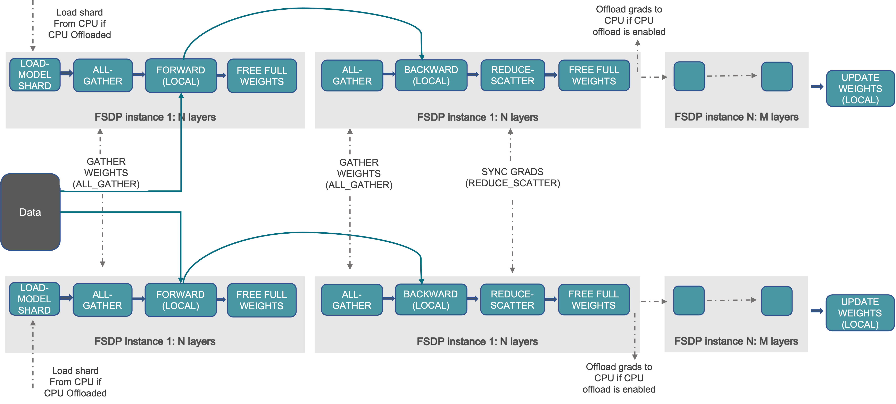
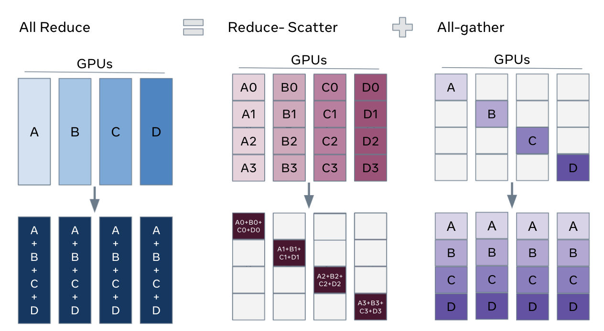
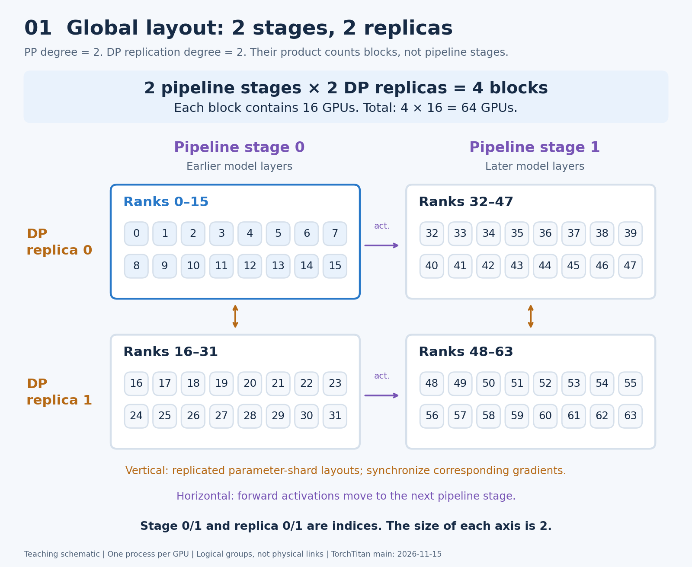
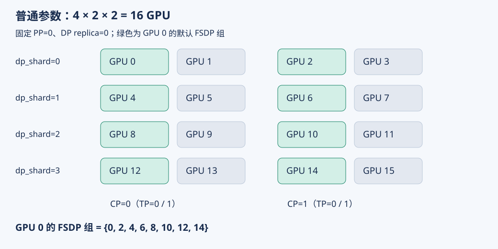
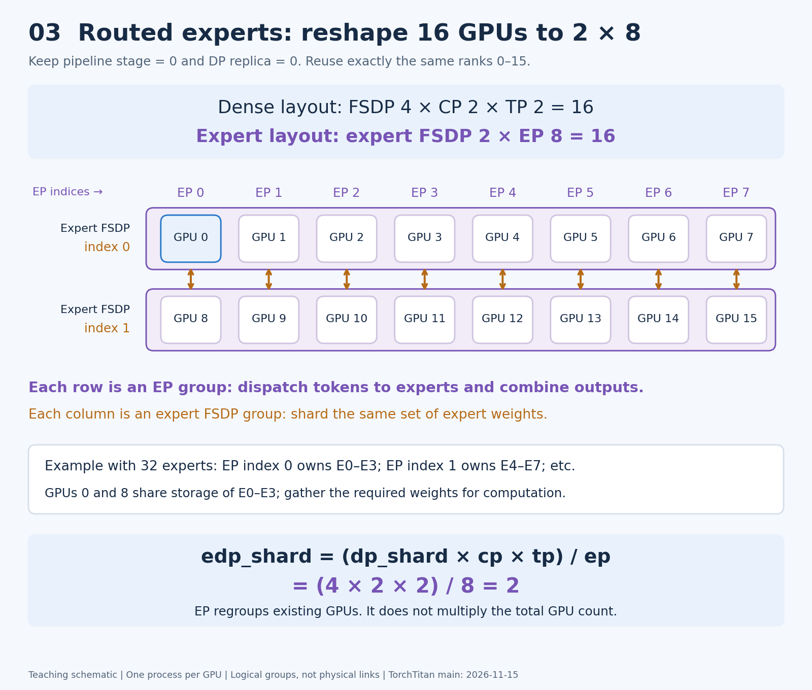
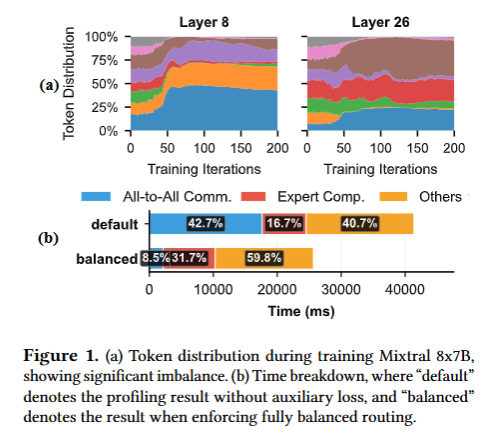
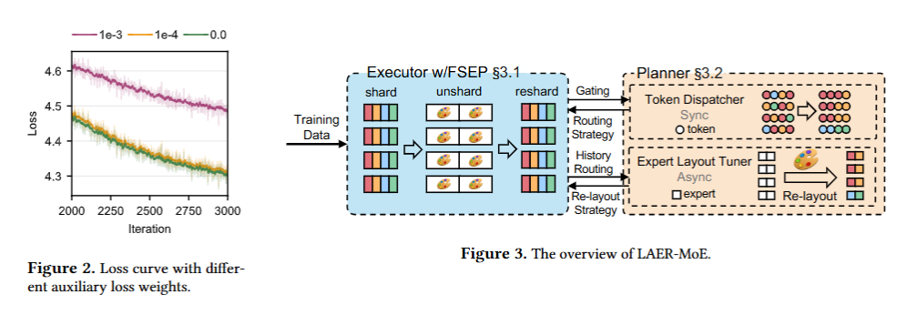
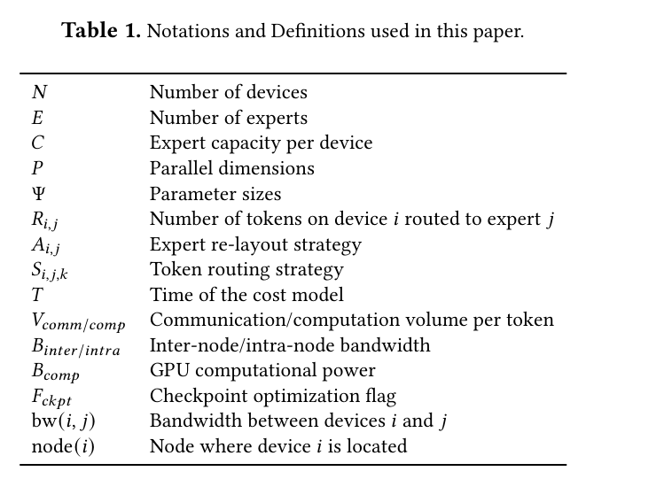
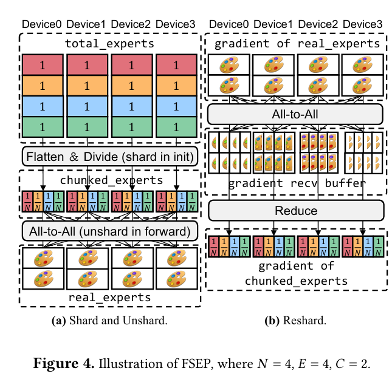
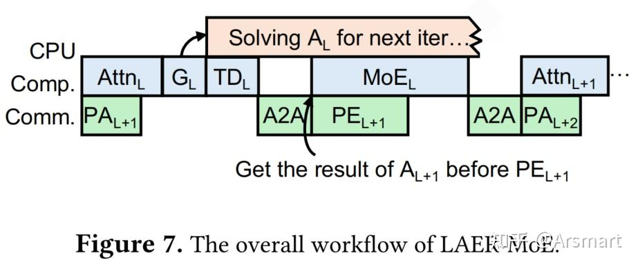

# FSDP、EP 与 TorchTitan 训练笔记

从数据并行、模型状态分片，到 MoE 专家布局与负载均衡。

[返回首页](../) · [打开 64 GPU 前向／反向交互图谱](../interactive/torchtitan-64gpu.html)

整理自[飞书笔记及评论](https://acndm63ox1j0.feishu.cn/docx/WAUNdLSqDoUuYOxFtmuckXCbnUe)。截图中的解释已转为表格、代码和问答；必要的论文图保留原图。TorchTitan 部分以源码版本 [`631d544b`](https://github.com/pytorch/torchtitan/tree/631d544b1f6794ecfeca734a7bba861e03ddd5e3) 为依据，修正了参数注释、普通 FSDP 通信组与模块归属。

## 阅读目录

- [DDP 与 FSDP](#ddp-fsdp)
- [64 GPU 的 dense / expert mesh](#mesh)
- [LAER-MoE：动态专家布局](#laer)
- [FSEP 参数与梯度流动](#fsep)
- [参考资料](#references)

<a id="ddp-fsdp"></a>
## 1. DDP 与 FSDP

DDP 和 FSDP 都服务于数据并行，但对模型状态的组织方式不同。

| 方面 | DDP | FSDP（全分片配置） |
| --- | --- | --- |
| 模型状态 | 每个数据并行副本保存完整参数、梯度和优化器状态 | 参数、梯度和优化器状态按组分片 |
| 计算之前 | 参数已在本地 | 收集当前 FSDP 单元所需的参数 |
| 主要优点 | 参数调度简单 | 减少模型状态显存 |
| 主要代价 | 模型状态重复存储 | 参数通信与分片调度 |
| 常见用途 | 单卡能容纳模型，希望增加训练吞吐 | 模型过大，或需要腾出更多显存给 batch / 激活 |

FSDP 的核心是：**平时分片保存，需要计算时临时拼齐，计算后按配置重新分片。** 它收集的是该计算单元所需的参数；与 TP 组合时，不代表每卡恢复整个模型的全部 TP 分片。



图中上下两行代表两张 GPU，处理不同样本；横向箭头是本卡执行，纵向虚线是通信。FSDP instance 是一起管理的参数单元，可以包含一层或多层。

| 阶段 | 含义 |
| --- | --- |
| LOAD MODEL SHARD | 准备本卡参数分片 |
| ALL-GATHER | 交换分片，恢复该单元所需权重 |
| FORWARD (LOCAL) | 使用相同权重，处理各自数据 |
| FREE FULL WEIGHTS | 根据 reshard 策略释放临时完整权重 |
| BACKWARD | 如权重已释放，先重新收集；计算激活梯度与参数梯度 |
| REDUCE-SCATTER / UPDATE | 归约并分片梯度，各卡更新自己负责的参数分片 |

### 三种通信操作



每列代表一张 GPU，上面是通信前，下面是通信后；图中归约采用求和。

| 操作 | 结果 |
| --- | --- |
| All-Reduce | 求和，每卡获得完整结果 |
| Reduce-Scatter | 求和，每卡获得结果的一段 |
| All-Gather | 拼接各卡已有的段，每卡获得完整结果；本身不求和 |

<a id="mesh"></a>
## 2. TorchTitan：同一批 GPU 的不同 mesh

mesh 给进程 rank 排列多维坐标，用这些坐标确定通信伙伴。它不会改变物理接线；张量切分、通信和计算由相应并行实现完成。这里按每 GPU 一个进程说明。

### 2.1 固定配置与坐标

```python
pipeline_parallel_degree = 2       # PP：按层拆为两个流水线阶段
data_parallel_replicate_degree = 2 # 复制对应参数分片，处理不同数据
data_parallel_shard_degree = 4     # dp_shard 轴大小；不等于全部 FSDP 组大小
context_parallel_degree = 2        # CP：切分序列位置
tensor_parallel_degree = 2         # TP：切分层内张量计算
expert_parallel_degree = 8         # EP：划分 routed experts
```

总 GPU 数为 `2 × 2 × 4 × 2 × 2 = 64`。EP 是同一批卡上的另一种视图，**不再乘一个 8**。

- dense 坐标：`[pp, dp_replicate, dp_shard, cp, tp]`。
- expert 坐标：`[pp, dp_replicate, edp_shard, ep]`，其中 `edp_shard = 4×2×2/8 = 2`。
- 一个 PP stage、一个 DP replica 内有 16 张卡。



图中横向是两个 PP stage，纵向是两份 DP replica。以 32 层均分为例，GPU 0–15 负责前半模型，GPU 32–47 负责后半模型；实际层划分由模型和 schedule 决定。PP 传递激活，反向传回激活梯度。

### 2.2 普通参数：FSDP 默认包含 CP

`resolve_fsdp_mesh()` 默认 `shard_on_cp_axis=True`，普通参数的 FSDP 分片轴为 `dp_shard × cp`。固定 TP 坐标后，GPU 0 的普通 FSDP 组是 **`[0,2,4,6,8,10,12,14]`**。



| GPU 0 的组 | rank 成员 | 用途 |
| --- | --- | --- |
| dp_shard 轴组 | 0, 4, 8, 12 | 单独一个坐标轴；不能直接等同默认普通 FSDP 组 |
| 普通 FSDP | 0, 2, 4, 6, 8, 10, 12, 14 | 普通参数 All-Gather、参数梯度 Reduce-Scatter |
| TP | 0, 1 | QKV / FFN 等张量并行计算 |
| CP | 0, 2 | 跨序列位置的 Attention 通信 |
| EP | 0, 1, 2, 3, 4, 5, 6, 7 | routed token 的 Dispatch / Combine |
| 专家 FSDP | 0, 8 | 相同专家集合的参数分片与梯度归约 |
| DP replicate | 0, 16 | 对应参数分片的副本同步 |
| PP | 0, 32 | 流水线阶段之间的激活 / 激活梯度传递 |

来源：[普通与专家 FSDP mesh 选择](https://github.com/pytorch/torchtitan/blob/631d544b1f6794ecfeca734a7bba861e03ddd5e3/torchtitan/distributed/fsdp.py#L124)。这是本配置的组成员关系，并不表示所有操作同时发生。

### 2.3 routed experts：2 路专家 FSDP × 8 路 EP



EP 0 是 EP 坐标，不是专家编号。若有 32 个专家，8 个 EP 位置各负责 4 个专家；此时 EP 0 对应 E0–E3。交互图谱另用 16 个专家的例子，因此每个 EP 位置对应 2 个专家；两者的 mesh 相同。

| 阶段（32 专家示例） | GPU 0 | GPU 8 |
| --- | --- | --- |
| 参数分片存储 | E0–E3 的一部分参数 | E0–E3 的另一部分参数 |
| 专家 FSDP All-Gather 后 | 完整 E0–E3，处理本组分配的 token | 完整 E0–E3，处理另一组分配的 token |
| 重新分片后 | 重新保留自身分片 | 重新保留自身分片 |

**MoE 并非整体都使用 expert mesh。** Router、共享专家和 routed experts 的布局不同：Router 在 dense 路径处理 token 并计算专家分数；共享专家按普通 FFN 的 TP 方式计算；被路由的专家参数才使用 sparse FSDP mesh。详细过程见[交互图谱](../interactive/torchtitan-64gpu.html)。

<details markdown="1">
<summary>知识卡片：mesh 可以怎样直观理解？</summary>

一个 `edp_shard=2 × ep=4` 的教学例子：

| 专家分片坐标 / EP 坐标 | EP 0 | EP 1 | EP 2 | EP 3 |
| --- | --- | --- | --- | --- |
| edp_shard 0 | GPU 0 | GPU 1 | GPU 2 | GPU 3 |
| edp_shard 1 | GPU 4 | GPU 5 | GPU 6 | GPU 7 |

每行是一个 EP 通信组，每列是一个专家 FSDP 组。横向决定 token 到哪个专家位置，纵向决定谁一起拼齐该位置的专家参数。这是简化的 8 卡例子，不是上面的完整 64 卡配置。

</details>

<details markdown="1">
<summary>知识卡片：没有 token 的专家，也要恢复参数吗？</summary>

不能只凭 Router 选中了哪些专家，就推断 FSDP 只收集那些专家的权重。普通 FSDP 聚合以参数单元为粒度；如果多个专家打包在同一个单元里，零 token 的专家也可能随单元一起恢复。

此外，前向后是否释放完整参数取决于策略。本图谱选择 `reshard_after_forward="always"`；此源码版本在 PP 开启、策略为 `default` 时不在前向后重新分片，可以避免每个 microbatch 再次收集参数。因此“前向后总会释放、反向前总会重新收集”不是通用结论。

来源：[reshard 策略](https://github.com/pytorch/torchtitan/blob/631d544b1f6794ecfeca734a7bba861e03ddd5e3/torchtitan/distributed/fsdp.py#L207)。

</details>

延伸阅读：[CP：从源码看 mesh 的组织（飞书）](https://acndm63ox1j0.feishu.cn/docx/RI50dhgAXo6Ybox3z7PcRUBFnMc)。

<a id="laer"></a>
## 3. LAER-MoE：动态调整专家布局

论文：[LAER-MoE: Load-Adaptive Expert Re-layout for Efficient Mixture-of-Experts Training](https://arxiv.org/abs/2602.11686)，ASPLOS 2026。名称是 **LAER-MoE**。

在普通 EP 中，专家位置固定。专家忙闲不均会转化为设备负载不均：

1. Dispatch All-to-All：把 token 隐藏状态发往专家设备。
2. Expert computation：各设备计算本地专家。
3. Combine All-to-All：把结果送回 token 原来的设备。

部分卡先算完，却仍需等待繁忙设备进入后续通信，所以看起来通信时间也变长了。

### 3.1 动机：需求不均衡，而且随层、迭代变化



左图的 Layer 8、Layer 26 表明：专家间负载不均，不同层分布不同，同一层的分布也会随迭代改变。Layer 8 约第 100 次迭代时，蓝色专家约占 45%，明显超过八专家均匀分配的 12.5%。

右图 `default` 是不使用负载均衡辅助损失的 profiling，`balanced` 是强制完全均衡路由的 profiling。图读数约从 41,000 ms 降到 25,500 ms，主要缩短通信部分。这是动机实验，**不能当作 LAER-MoE 的端到端实测加速结论**。

一种系统侧思路是：某专家收到 400 份任务，在两张卡恢复相同参数，各处理 200 份；token 仍交给原来选中的逻辑专家，只改变执行副本。

训练还需保存梯度和优化器状态，因此参数、梯度、状态的分片组织尤其重要。FSEP 使持久存储位置与临时计算副本布局解耦，避免每次调整计算布局都搬迁全部优化器状态。

### 3.2 辅助损失与系统布局是不同手段



常见训练目标为：

$$L_{\mathrm{train}} = L_{\mathrm{task}} + \lambda L_{\mathrm{balance}}.$$

较强的均衡约束可能使单步更快，却需要更多步达到相同任务 loss。图中结果应限于相应配置，不能概括为所有辅助损失都不利。

<details markdown="1">
<summary>读图问答：图 2 只画了后半段，能否据此判断起始差距与收敛？</summary>

只看截取区间无法确定早期曲线。论文 Figure 9(a) 给出了覆盖更早迭代的收敛对比，但它不是可以直接拼接到 Figure 2 前面的同一配置曲线。比较时要分清横轴是训练步数还是墙钟时间，以及辅助损失权重是否一致。

论文 §5.2 的 Mixtral-8x7B e8k2、4K 序列实验中，LAER-MoE 与同为 `1e-4` 辅助损失权重的 Megatron 收敛接近；不能把不同权重的差异归因为 FSEP 改变了模型语义。

[对应论文段落与 Figure 9](https://arxiv.org/html/2602.11686v1#S5.SS2)

</details>

### 3.3 谁决定专家，谁决定副本？

| 模块 | 决策 / 数据 | 时间与位置 |
| --- | --- | --- |
| Gating | token 选择哪些逻辑专家 | 当前层、当前迭代 |
| Token Dispatcher | token 发往所选专家的哪个设备副本 | 当前实际需求，在线 GPU 路径 |
| History Routing | 历史专家需求与负载 | 为布局规划提供信息 |
| Expert Layout Tuner | 每个专家有几个副本、放在哪些设备 | CPU 异步，为同一层下一迭代准备 |
| FSEP Executor | 分片、按布局恢复专家、回收并归约梯度 | 执行上述布局 |



| 符号 | 含义 | 来源 |
| --- | --- | --- |
| `R[i,j]` | 源设备 i 的 token 对专家 j 的需求数 | 当前 Gating |
| `A[i,j]` | 设备 i 是否放置专家 j 的计算副本 | Layout Tuner |
| `S[i,j,k]` | 源设备 i 对专家 j 的需求有多少分配给设备 k | Token Dispatcher |

<details markdown="1">
<summary>知识卡片：当前路由、历史预测和跨层预取，分别发生在什么时候？</summary>

| 时刻 | 已知信息 | 用途 |
| --- | --- | --- |
| 迭代 t，第 L 层 Gating 后 | 当前真实需求 R | 执行当前分发；规划同一层下次迭代的布局 |
| 迭代 t+1，第 L 层 Gating 前 | 先前计划好的布局 A | 提前准备专家参数 |
| 迭代 t+1，第 L 层 Gating 后 | 新的真实需求 R | 将 token 分发到现有专家副本 |

这里有两个不同的时间方向：布局使用**同一层跨迭代**的信息；流水线中参数可以从第 L 层计算期间预取第 L+1 层。后者不等于用第 L 层 Router 的结果替代第 L+1 层的真实路由。

如果历史负载判断失准，热门专家副本不足会影响均衡和性能；token 仍应送往它真正选中的专家。比如 E0 有三个副本、E2 一个副本，而当前 E2 突然变热，不能为了均衡把 E2 的 token 改送 E0。论文规划保留专家覆盖，再分配额外副本。

</details>

<details markdown="1">
<summary>性能卡片：在线分发和 CPU 布局求解会不会太慢？</summary>

论文 Table 3 的两个 Mixtral 配置中，lite routing 分别占总时间 `0.084%` 与 `0.094%`。这是该实验中的占比，不是任意硬件和规模的保证。

CPU 布局求解见 Figure 11：N 是设备数，C 是每设备专家容量，候选分配方案数固定为 2。灰色虚线是参考模型每 Transformer 层的平均时间，用来比较求解能否被计算覆盖；不能把求解用时理解成全部串行加到训练迭代上。

[论文 §5.4：Table 3 与 Figure 11](https://arxiv.org/html/2602.11686v1#S5.SS4)

</details>

<a id="fsep"></a>
## 4. FSEP：参数恢复、梯度返回与优化器更新



图左展示权重：先按专家展开，再重排成设备分片优先的顺序，由 FSDP 保存分片。计算前，根据布局通过 All-to-All 收集需要的专家分片，拼成计算副本。

“所需专家”指布局分配给本设备的专家，不能简单解释为对每个 token 单独按需加载权重，也不代表在 Gating 前就知道下一层的全部真实需求。

### 4.1 从评论截图展开：4 个专家、4 张卡

每个专家有 8 个参数：E0 为 `a0…a7`，E1 为 `b0…b7`，E2 为 `c0…c7`，E3 为 `d0…d7`。

```python
# E=4 个专家，N=4 张卡，每个专家被切成 4 段，每段 2 个参数
flat = flat.reshape(E, N, -1)  # [专家, 分片编号, 分片内参数]
flat = flat.permute(1, 0, 2)   # [分片编号, 专家, 分片内参数]
flat = flat.reshape(-1).contiguous()
# 随后交给 FSDP 按设备切分
```

| 持有者 | 本地连续参数分片 |
| --- | --- |
| GPU 0 | a0,a1, b0,b1, c0,c1, d0,d1 |
| GPU 1 | a2,a3, b2,b3, c2,c3, d2,d3 |
| GPU 2 | a4,a5, b4,b5, c4,c5, d4,d5 |
| GPU 3 | a6,a7, b6,b7, c6,c7, d6,d7 |

每卡持有每个专家的四分之一。恢复 E0 时，需要从各卡取得对应的 a 分片，而不是把其它专家也恢复完整。

[对应固定版本代码](https://github.com/PKU-DAIR/Hetu-Galvatron/blob/27042374b3306c964b07f4a24a2a9134af9e634d/galvatron/core/runtime/moe/prefetch/fsdp_patch.py#L451)

### 4.2 图右：计算副本产生梯度，分片持有者负责更新

`gradient of real_experts` 是各计算副本得到的参数梯度。它们按参数位置送回持有者并归并，再由持有者结合优化器状态更新自己的分片。下次恢复专家时，使用更新后的分片。

<details markdown="1">
<summary>问答：本卡已有完整权重和梯度，为什么不能直接更新整个专家？</summary>

同一逻辑专家可能有多个计算副本，各自处理不同 token。

| 设备 | 处理数据 | 梯度 |
| --- | --- | --- |
| GPU 0 | token 集合 A | gA |
| GPU 1 | token 集合 B | gB |

若各自执行 `W0 = W - lr*gA`、`W1 = W - lr*gB`，副本会变成不同的专家。必须先汇总同一逻辑参数的梯度贡献，并按训练的归一化约定更新。

而且完整计算权重只是临时副本：Adam 的一阶、二阶状态仍跟随参数分片保存。执行完整专家计算的卡通常不具备该专家的全部优化器状态。

因此流程是：副本算梯度 → 按参数位置返回持有者 → 归并梯度 → 更新本地分片 → 下次收集更新后的参数。

</details>

<details markdown="1">
<summary>知识卡片：优化器状态到底存了什么、放在哪里？</summary>

飞书评论所分析的实现使用 Apex FusedAdam。对已经 FSDP/FSEP 包装的参数，优化器看到的是本卡参数分片。

| 对象 | 典型位置 | 含义 |
| --- | --- | --- |
| 参数 w | `p.data` | 当前参数分片 |
| 梯度 g | `p.grad` | 当前反向汇总后的梯度分片 |
| 一阶矩 m | `optimizer.state[p]['exp_avg']` | 历史梯度的指数移动平均 |
| 二阶矩 v | `optimizer.state[p]['exp_avg_sq']` | 历史梯度平方的指数移动平均 |

参数和梯度不等于 `state[p]` 中的两个 Adam 状态。后者不是保存完整历史梯度列表，而是为每个参数元素维护累计统计：

$$m_t=\beta_1m_{t-1}+(1-\beta_1)g_t,\qquad v_t=\beta_2v_{t-1}+(1-\beta_2)g_t^2.$$

评论截图中的初始化 `zeros_like(p.data).float()` 表明：该实现的状态与本地参数分片同形、同设备，状态精度为 FP32。这是具体实现行为，不应推广为所有优化器和 offload 配置都如此。

[LAER 实现仓库](https://github.com/PKU-DAIR/Hetu-Galvatron/tree/laer-moe) · [Apex FusedAdam](https://github.com/NVIDIA/apex/blob/master/apex/optimizers/fused_adam.py)

</details>

### 4.3 工作流水线



横向是时间；三行分别是 CPU 规划、GPU 计算与 GPU 通信。上下对齐表示可重叠。

1. 计算当前 `Attn_L`，同时预取下一层 Attention 参数 `PA_(L+1)`。
2. `G_L` 得到当前真实路由，交给当前 `TD_L`（第 L 层 Token Dispatcher）；CPU 同时为第 L 层下一迭代求解布局。
3. `TD_L` 选定执行副本，进行 Dispatch A2A。
4. 计算 `MoE_L`，同时预取下一层专家参数 `PE_(L+1)`；后者使用事先为下一层计划好的布局。
5. Combine A2A 返回专家输出，随后进入下一层。

<details markdown="1">
<summary>延伸问题：能否复用跨层 Router 或提前决定路由？</summary>

这是评论提出的另一个研究方向，需要与 LAER 的跨迭代布局规划分开。可继续比较以下问题：共享 Router 参数是否仍对每层 hidden state 重新计算；提前路由是否改变模型结构；预测只用于预取还是替代真实路由；共享的是 Router 还是专家参数。

- [Path-Constrained Mixture-of-Experts / PathMoE](https://arxiv.org/abs/2603.18297)：关注相邻层的路径约束与 Router 共享。
- [ReXMoE](https://arxiv.org/abs/2510.17483)：关注跨层专家复用。
- Pre-gated MoE 与预测式专家预取是可进一步阅读的方向；不能把它们等同为 LAER 已采用的机制。

</details>

<a id="references"></a>
## 5. 参考资料

- [PyTorch DDP 入门](https://docs.pytorch.org/tutorials/intermediate/ddp_tutorial.html)
- [PyTorch FSDP 入门](https://docs.pytorch.org/tutorials/intermediate/FSDP_tutorial.html)
- [TorchTitan 固定源码版本](https://github.com/pytorch/torchtitan/tree/631d544b1f6794ecfeca734a7bba861e03ddd5e3)
- [配置式分片与 Full DTensor](https://docs.pytorch.org/devlogs/distributed/2026-08-17-config-based-sharding-full-dtensor/)
- [PyTorch / TorchTitan 1T MoE 训练案例](https://pytorch.org/blog/training-a-1t-parameter-moe-on-eu-public-infrastructure-with-pytorch-and-torchtitan/)
- [MegaBlocks MoE 源码](https://github.com/databricks/megablocks/blob/main/megablocks/layers/moe.py)
- [LAER-MoE 论文](https://arxiv.org/abs/2602.11686) · [ACM 版本](https://dl.acm.org/doi/10.1145/3779212.3790180) · [实现](https://github.com/PKU-DAIR/Hetu-Galvatron/tree/laer-moe)
- [原笔记收录的 FSEP 中文讨论](https://zhuanlan.zhihu.com/p/2021578704350913922)

[继续：64 GPU 前向／反向交互图谱 →](../interactive/torchtitan-64gpu.html)
